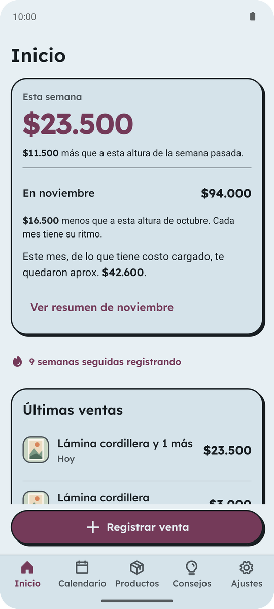
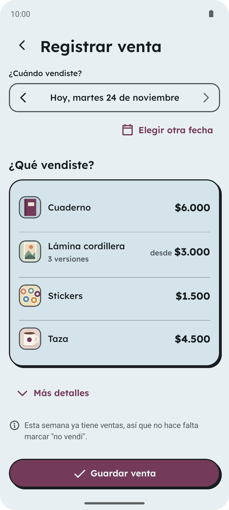
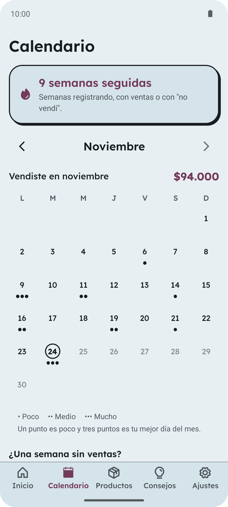

<p align="center">
  
</p>

<h1 align="center">Kofi</h1>

<p align="center">
  A calm business companion for artists and small makers.
</p>

<p align="center">
  
  &nbsp;&nbsp;
  
  &nbsp;&nbsp;
  
</p>

## Why Kofi

Most people who sell what they make never set out to run the numbers. Spreadsheets feel like homework, and accounting apps assume you already know the language.

Kofi works more like a habit tracker than a ledger. You note what you sold, at the end of a fair or at the end of the week, and it shows you your rhythm. Along the way you come to understand your money: what comes in, what your work costs you, and what you keep.

## What guides it

- **Recording is quick.** A few taps, with everything optional out of the way until you ask for it.
- **Nothing is demanded.** Costs and profit appear once there is data that makes them useful.
- **It never scolds.** A week without sales is also worth recording, and it keeps your streak going.
- **Your data stays with you.** No account, no server, and nothing sent to the internet. Data leaves your phone only when you share a backup or an export.

## What it does

- Records sales by product, version, quantity and price.
- Shows weekly and monthly totals, a sales calendar and a monthly summary.
- Offers short, practical tips after a sale.
- Sends gentle weekly reminders that you can turn off.
- Exports to CSV, and backs up and restores everything, photos included.

The interface is in Spanish, and amounts are in Chilean pesos (CLP).

## Status

Version 1 is local only and not published in any store. It is built and tested on Android. The codebase also targets iOS, which has not been verified yet.

## Development

Built with Expo, React Native and TypeScript, on SQLite with Drizzle, HeroUI Native and Uniwind.

Requires Node.js 22 or later. Building for Android also needs the Android SDK and a JDK.

```sh
npm install
npm run android
```

Run the checks with:

```sh
npm run typecheck
npm run lint
npm test
```

## Kofi on an iPhone (Expo Go)

Kofi can run on an iPhone without signing the app or building it on a Mac, using Expo Go from the App Store and EAS Update on the free Expo plan (ADR-022). Only the JavaScript bundle and its assets are uploaded; the data never leaves the phone.

Requirements: an Expo account, Expo Go for SDK 58 signed in with that account, and `npx eas-cli@27.11.0 login` plus `npx eas-cli@27.11.0 init` already done in this repository.

1. Commit your changes. The script only publishes a clean tree and never commits.
2. Run `npm run publish:ios-go`. It runs the checks, publishes to the `ios-go` branch and prints a fixed link and a QR URL. If there are new migrations, export a backup on the iPhone first and add `-- --with-migration`.
3. Open the link in Expo Go, or scan the QR, and save the link.

Kofi's data lives inside Expo Go. If Expo Go is deleted, the data is lost, so export backups regularly and keep them outside Expo Go (for example in Files).

Technical decisions are recorded in [docs/architecture](docs/architecture/README.md), and the product vision is in [docs/product.md](docs/product.md). Both are in Spanish.

The screenshots use sample data.
