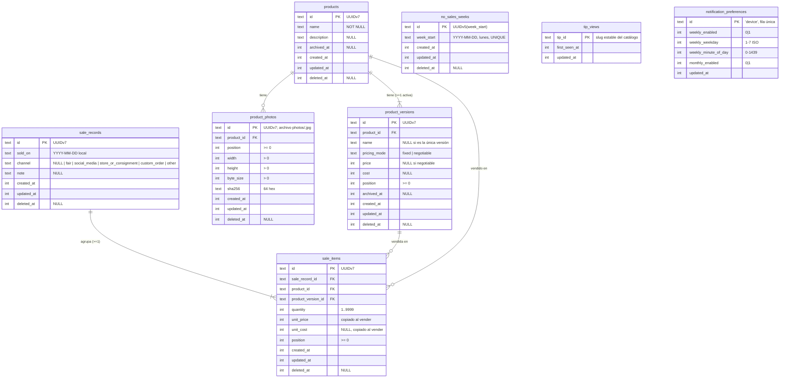

# ADR-007: Modelo de datos

- **Estado**: Aceptado
- **Fecha**: 2026-11-12 (revisado 2026-11-13 tras la revisión del reviewer; enmendado el 2026-11-13, ver "Enmiendas")
- **Depende de**: ADR-006 (convenciones sync-ready), ADR-015 (fechas y zonas horarias).

## Contexto
`docs/product.md` define:
- **Productos** con fotos y versiones. Cada versión tiene precio fijo o "a convenir", y un costo opcional.
- **Registros de venta** con ítems, fecha, canal y nota.
- La marca **"esta semana no vendí"**.
- **Consejos vistos** y **preferencias de notificación**.

Los productos se **archivan, no se borran**. La ganancia aproximada aparece solo cuando hay costos. La racha cuenta semanas seguidas con ventas o "no vendí".

## Opciones consideradas

### "Esta semana no vendí"
- **Un registro de venta con `kind = 'no_sales'` y sin ítems**: mezcla un concepto semanal con uno diario y permite estados inválidos.
- **Tabla propia `no_sales_weeks`** con un id determinista derivado de la semana: modela el concepto tal cual, y la unicidad la impone la PK incluso entre dispositivos.

### Id de "no vendí"
- **UUID aleatorio + índice único parcial**: dos dispositivos que marcan la misma semana crean dos filas distintas que chocan al sincronizar.
- **`week_start` como PK**: no hay choques, pero rompe la convención de id UUID.
- **UUIDv5 de `week_start`** con el namespace de la app: el mismo id en todos los dispositivos, sin romper la convención. **Elegida.**

### Precio y costo del ítem
- Usar siempre el precio actual: reescribe el historial. Incorrecto.
- Copiar el precio en el ítem (`unit_price`): correcto, es lo que realmente se cobró.
- Para el costo, ver la regla 6.

### Nombre del archivo de foto
- **Columna `file_name` libre**: un respaldo manipulado podría traer `../../algo` (path traversal).
- **Nombre derivado del id** (`${id}.jpg`), sin columna: no hay nada que validar ni que se desincronice. **Elegida.** Si algún día cambia el formato, se agrega una columna `format` por migración.

## Decisión

### Diagrama


`sale_items.product_id` está desnormalizado para consultar "producto más vendido" sin unir con versiones. El repositorio valida al insertar que coincida con `product_versions.product_id`, y hay un test que lo cubre.

### Excepciones documentadas a las convenciones de ADR-006
- **`tip_views`**: la PK es el slug del catálogo (estable y compartido por todos los dispositivos), no un UUID. No tiene `deleted_at`, porque "visto" no se deshace. Al sincronizar se fusiona por unión: gana el `first_seen_at` más antiguo.
- **`notification_preferences`**: fila única con id `'device'`, **propia del dispositivo y no sincronizable**. No tiene `created_at` ni `deleted_at`. No entra en el respaldo.
- **`no_sales_weeks`**: id determinista UUIDv5. Desmarcar pone `deleted_at`; volver a marcar limpia `deleted_at` en la misma fila.

### Restricciones en la base
- **Dinero** (`price`, `cost`, `unit_price`, `unit_cost`): `CHECK (x BETWEEN 0 AND 999999999)`.
- **`pricing_mode`**: `CHECK (pricing_mode IN ('fixed','negotiable'))`, más `CHECK ((pricing_mode = 'fixed' AND price IS NOT NULL) OR (pricing_mode = 'negotiable' AND price IS NULL))`.
- **Valores numéricos**:
  - `quantity BETWEEN 1 AND 9999`;
  - `position >= 0`;
  - `width > 0`, `height > 0`, `byte_size > 0`;
  - `length(sha256) = 64 AND sha256 NOT GLOB '*[^0-9a-f]*'`.
- **Canal**: `CHECK (channel IS NULL OR channel IN ('fair','social_media','store_or_consignment','custom_order','other'))`.
- **Fechas**: `sold_on` y `week_start` cumplen `length(x) = 10 AND date(x) IS NOT NULL AND date(x) = x`, y además `strftime('%w', week_start) = '1'` (lunes). El `IS NOT NULL` es necesario: `date('2026-13-01')` devuelve NULL y un CHECK con NULL no falla (corrección detectada en F0.9).
- **Preferencias**:
  - `weekly_weekday BETWEEN 1 AND 7` y `weekly_minute_of_day BETWEEN 0 AND 1439`;
  - `weekly_enabled IN (0,1)` y `monthly_enabled IN (0,1)`;
  - `id = 'device'`.
- **Unicidad**: `UNIQUE (week_start)` en `no_sales_weeks`.
- **Índices**: `sale_records(sold_on, created_at, id) WHERE deleted_at IS NULL`, `sale_items(sale_record_id)`, `sale_items(product_version_id)`, `sale_items(product_id)`, `product_versions(product_id)`, `product_photos(product_id)`.
- Todas las FK con `ON DELETE RESTRICT`.

### Reglas de integridad (dominio, funciones puras con tests)
1. **Productos**: se archivan (`archived_at`), nunca se borran. Uno archivado no aparece en la lista activa ni en el selector de nuevas ventas. Las ventas pasadas muestran su nombre **actual**, con un indicador de "archivado". Se puede desarchivar.
2. **Versiones**: se **archivan igual que los productos**, como dice `docs/product.md`, también si no tienen ventas. Un producto activo tiene siempre al menos una versión activa. **Decisión**: una versión que **nunca se usó en una venta** se puede borrar lógicamente (`deleted_at`) y no aparece en "archivados"; si tiene ventas, solo se archiva.
3. **Nombres de versión**: con exactamente una versión activa, el nombre puede ser `NULL` y la UI no muestra el concepto. Con dos o más, todas deben tener un nombre no vacío y único dentro del producto, sin distinguir mayúsculas ni tildes.
4. **El precio histórico manda**: `unit_price` es lo que se cobró. Cambiar el precio de una versión nunca altera las ventas existentes.
5. **"A convenir"**: la versión no tiene precio y el ítem exige `unit_price` (se acepta `0`).
6. **Costo efectivo del ítem** (decisión): `unit_cost` si se copió al vender; si no, el costo actual de la versión.
7. **Ganancia aproximada** = Σ cantidad × (precio − costo efectivo), **solo sobre los ítems con costo efectivo** (decidido en `docs/product.md`). Puede ser negativa. Si la cobertura es parcial (`revenueWithCost < revenueTotal`), la UI usa el texto "de lo que tiene costo cargado, te quedaron aprox. $X". La función recibe los costos actuales de forma explícita:

```ts
/**
 * Calcula la ganancia aproximada de un conjunto de registros.
 *
 * @param records - Registros del período.
 * @param currentCostByVersion - Costo actual de cada versión vendida, para los ítems sin costo copiado.
 * @returns Ganancia y cobertura de costos; `null` si ningún ítem tiene costo efectivo.
 */
export function approximateProfit(
  records: readonly SaleRecord[],
  currentCostByVersion: ReadonlyMap<ProductVersionId, Clp | null>,
): ProfitSummary | null;

/** Ganancia aproximada y qué parte de lo vendido tenía costo. */
export interface ProfitSummary {
  readonly profit: SignedClp;
  readonly revenueWithCost: Clp;
  readonly revenueTotal: Clp;
}
```

   El hook de seguimiento arma el mapa con `ProductRepository.currentCostsFor(versionIds)`.
8. **Un registro de venta tiene al menos un ítem activo.** Quitar el último ítem equivale a borrar el registro, con confirmación.
9. **Los totales se derivan** y nunca se almacenan.
10. **Semana**: lunes a domingo (ISO 8601, decisión). Las reglas de fechas están en ADR-015.
11. **Racha**: semanas consecutivas con al menos un `sale_record` activo o una `no_sales_week` activa, contadas hasta la semana actual o la anterior. La semana en curso no rompe la racha mientras no haya terminado.
12. **Editar un registro** actualiza los ítems por id (insertar, actualizar o borrar lógicamente). Nunca se reemplazan todos.
13. **Consejos**: el catálogo está incluido en el código, detrás de `TipCatalog`. En la base solo se guarda `tip_views`.
14. **Preferencias por defecto**: semanal activado, domingo (7) a las 20:00 (1200); mensual activado.
15. **Tolerancia a invariantes rotas.** Un futuro merge de sync o un respaldo antiguo pueden dejar estados que las reglas 2, 3 u 8 no permitirían crear: un producto sin versión activa, dos versiones con el mismo nombre o un registro sin ítems activos.
    - Las funciones de **lectura y cálculo** no fallan ante esos estados: un registro sin ítems suma 0 y un producto sin versión activa se muestra con aviso para corregirlo.
    - Solo las **fábricas y comandos de escritura** exigen las invariantes.
    - Cada caso tiene su test.

### Tipos de dominio (definidos una sola vez)
Los tipos con marca se definen **una sola vez, como esquemas Zod en `shared/domain`**, y se infieren (ADR-010):

```ts
/** Esquema y tipo de un monto CLP no negativo (ver ADR-010). */
export const clpSchema = z.number().int().min(0).max(999_999_999).brand<'Clp'>();
/** Monto en pesos chilenos, entero sin decimales, entre 0 y 999.999.999. */
export type Clp = z.infer<typeof clpSchema>;

/** Monto CLP con signo, para resultados como la ganancia. */
export const signedClpSchema = z.number().int().min(-999_999_999).max(999_999_999).brand<'SignedClp'>();
/** Monto en pesos chilenos que puede ser negativo. */
export type SignedClp = z.infer<typeof signedClpSchema>;

/** Fecha calendario local `YYYY-MM-DD` (ADR-015). */
export type LocalDate = z.infer<typeof localDateSchema>;

/** Instante en milisegundos desde epoch UTC. */
export type EpochMs = z.infer<typeof epochMsSchema>;

/** UUID generado en el cliente. */
export type Uuid = z.infer<typeof uuidSchema>;

/** Identificador de producto. */
export type ProductId = z.infer<typeof productIdSchema>;
/** Identificador de versión de producto. */
export type ProductVersionId = z.infer<typeof productVersionIdSchema>;
/** Identificador de foto de producto; determina el archivo `photos/<id>.jpg`. */
export type ProductPhotoId = z.infer<typeof productPhotoIdSchema>;
/** Identificador de registro de venta. */
export type SaleRecordId = z.infer<typeof saleRecordIdSchema>;
/** Identificador de ítem de venta. */
export type SaleItemId = z.infer<typeof saleItemIdSchema>;
/** Identificador determinista de una semana sin ventas. */
export type NoSalesWeekId = z.infer<typeof noSalesWeekIdSchema>;

/** Día ISO de la semana: 1 = lunes, 7 = domingo. */
export type IsoWeekday = 1 | 2 | 3 | 4 | 5 | 6 | 7;

/** Precio de una versión: fijo o a convenir al momento de vender. */
export type VersionPricing =
  | { readonly mode: 'fixed'; readonly price: Clp }
  | { readonly mode: 'negotiable' };

/** Modalidad de venta de un producto (por ejemplo "Print A4"). */
export interface ProductVersion {
  readonly id: ProductVersionId;
  readonly productId: ProductId;
  readonly name: string | null;
  readonly pricing: VersionPricing;
  readonly cost: Clp | null;
  readonly position: number;
  readonly archivedAt: EpochMs | null;
}

/** Foto de un producto; el archivo `photos/<id>.jpg` vive fuera de la base (ADR-008). */
export interface ProductPhoto {
  readonly id: ProductPhotoId;
  readonly productId: ProductId;
  readonly position: number;
  readonly width: number;
  readonly height: number;
  readonly byteSize: number;
  readonly sha256: string;
}

/** Producto con sus versiones y fotos activas. */
export interface Product {
  readonly id: ProductId;
  readonly name: string;
  readonly description: string | null;
  readonly versions: readonly ProductVersion[];
  readonly photos: readonly ProductPhoto[];
  readonly archivedAt: EpochMs | null;
  readonly createdAt: EpochMs;
  readonly updatedAt: EpochMs;
}

/** Dónde se vendió; códigos estables, las etiquetas en español viven en la UI. */
export type SaleChannel = 'fair' | 'social_media' | 'store_or_consignment' | 'custom_order' | 'other';

/** Línea de un registro de venta con el precio realmente cobrado. */
export interface SaleItem {
  readonly id: SaleItemId;
  readonly productId: ProductId;
  readonly productVersionId: ProductVersionId;
  readonly quantity: number;
  readonly unitPrice: Clp;
  readonly unitCost: Clp | null;
  readonly position: number;
}

/** Lo vendido en una misma ocasión (por ejemplo, una feria completa). */
export interface SaleRecord {
  readonly id: SaleRecordId;
  readonly soldOn: LocalDate;
  readonly channel: SaleChannel | null;
  readonly note: string | null;
  readonly items: readonly SaleItem[];
  readonly createdAt: EpochMs;
  readonly updatedAt: EpochMs;
}

/** Marca de "esta semana no vendí"; `weekStart` es siempre un lunes. */
export interface NoSalesWeek {
  readonly id: NoSalesWeekId;
  readonly weekStart: LocalDate;
}

/** Preferencias de notificación del dispositivo (no sincronizables). */
export interface NotificationPreferences {
  readonly weekly: {
    readonly enabled: boolean;
    readonly weekday: IsoWeekday;
    readonly minuteOfDay: number;
  };
  readonly monthly: { readonly enabled: boolean };
}

/** Consejo del catálogo incluido en la app. */
export interface Tip {
  readonly id: string;
  readonly title: string;
  readonly body: string;
  readonly topic: 'recording' | 'costs' | 'pricing' | 'general';
}

/** Fuente de consejos; hoy incluida en la app, en el futuro remota. */
export interface TipCatalog {
  all(): readonly Tip[];
}
```

> **Enmendado el 2026-11-13**: el tipo `Tip` de arriba quedó reemplazado. Ver "Enmiendas", punto 1.

### Interfaces de repositorio (firmas)
```ts
/** Cursor estable para paginar registros de venta del más nuevo al más antiguo. */
export interface SaleRecordCursor {
  readonly soldOn: LocalDate;
  readonly createdAt: EpochMs;
  readonly id: SaleRecordId;
}

/** Página de registros de venta con el cursor de la siguiente, si existe. */
export interface SaleRecordPage {
  readonly records: readonly SaleRecord[];
  readonly next: SaleRecordCursor | null;
}

/** Acceso a productos; oculta el motor de persistencia. */
export interface ProductRepository {
  listActive(): Promise<readonly Product[]>;
  listArchived(): Promise<readonly Product[]>;
  findById(id: ProductId): Promise<Product | null>;
  findVersionsByIds(ids: readonly ProductVersionId[]): Promise<readonly ProductVersion[]>;
  currentCostsFor(ids: readonly ProductVersionId[]): Promise<ReadonlyMap<ProductVersionId, Clp | null>>;
  save(product: Product): Promise<void>;
  setArchived(id: ProductId, archivedAt: EpochMs | null, now: EpochMs): Promise<void>;
}

/** Acceso a registros de venta; los rangos de fechas son cerrados. */
export interface SaleRepository {
  listBetween(from: LocalDate, to: LocalDate): Promise<readonly SaleRecord[]>;
  listRecent(limit: number, cursor?: SaleRecordCursor): Promise<SaleRecordPage>;
  findById(id: SaleRecordId): Promise<SaleRecord | null>;
  save(record: SaleRecord): Promise<void>;
  softDelete(id: SaleRecordId, now: EpochMs): Promise<void>;
}

/** Acceso a las marcas de "no vendí"; el id lo deriva el dominio de la semana. */
export interface NoSalesWeekRepository {
  listBetween(from: LocalDate, to: LocalDate): Promise<readonly NoSalesWeek[]>;
  mark(week: NoSalesWeek, now: EpochMs): Promise<void>;
  unmark(id: NoSalesWeekId, now: EpochMs): Promise<void>;
}
```

`listRecent` ordena por `(sold_on DESC, created_at DESC, id DESC)` y pagina con *keyset* sobre esa tupla. Las entidades se construyen con fábricas puras que reciben `Clock` e `IdGenerator` y devuelven `Result`. Los repositorios solo persisten entidades válidas.

## Consecuencias
- Los cálculos de seguimiento son funciones puras sobre registros acotados y mapas de costos explícitos.
- El id determinista de "no vendí" y el nombre de foto derivado del id eliminan dos clases de errores de sincronización y de seguridad.
- Copiar `unit_price` y usar borrado lógico deja un historial estable.
- Los gastos (fase siguiente) serán una tabla nueva.

## Decisiones de producto aplicadas (antes preguntas abiertas; aprobadas con los ADRs)
1. **Semana** de lunes a domingo (ISO).
2. **"No vendí" un lunes o un martes**: marca la semana en curso, salvo que la semana anterior no tenga registro. En ese caso se pregunta "¿la semana pasada o esta?", con la pasada preseleccionada.
3. **Venta en una semana marcada "no vendí"**: la venta gana y la marca se quita sola (borrado lógico), con un aviso suave. Se hace en la misma transacción que guarda la venta.
4. **Costo efectivo**: el copiado al vender o, si no hay, el actual de la versión.
5. **Ganancia parcial**: solo sobre los ítems con costo, con el texto "de lo que tiene costo cargado, te quedaron aprox. $X" (`docs/product.md`).
6. **Fechas futuras**: no se permiten; solo hoy o días pasados (`soldOn <= useToday()`, validado en el dominio).
7. **Edición y borrado de registros**: se permiten, con confirmación al borrar (borrado lógico).
8. **Primera versión al agregar la segunda**: se pide su nombre en ese momento, con la sugerencia "Estándar".
9. **Versión sin ventas**: se puede borrar lógicamente; con ventas, solo se archiva.
10. **Límites de longitud**: nombres de producto y de versión 80 caracteres, descripción 1000, nota 500.

## Enmiendas

### 2026-11-13 — Categorías y contextos de los consejos (F6.0)
- **Origen**: nota 13 de la sección 2.3 de `docs/plan-v1.md`. El contenido aprobado (`docs/content/consejos.md`, F6.1) usa seis categorías y cinco contextos de prioridad, mientras que `Tip.topic` tenía cuatro valores. **Decisión del orquestador**: se adoptan las seis categorías del contenido y se registra como enmienda de este ADR, sin un ADR nuevo. El detalle está en `docs/architecture/tips.md`.
- **No cambia el esquema** de la base: no hay migración.

1. **Tipo `Tip`** (reemplaza al de "Tipos de dominio"). `topic` pasa a llamarse `category`, con los seis valores del contenido. Se agrega `trigger`, el contexto en el que el consejo tiene prioridad. El id pasa a ser un `TipId` con marca, definido por su esquema (ADR-010):

   ```ts
   /** Categorías del contenido aprobado; los textos en español viven en la UI. */
   export const TIP_CATEGORIES = ['recording', 'costs', 'pricing', 'fairs', 'social_media', 'money_flow'] as const;
   export type TipCategory = (typeof TIP_CATEGORIES)[number];

   /** Contextos de prioridad después de una venta. */
   export const TIP_TRIGGERS = ['no_costs', 'first_sale', 'streak', 'no_channel', 'fair_sale'] as const;
   export type TipTrigger = (typeof TIP_TRIGGERS)[number];

   /** Slug estable en kebab-case; fuente única de `TipId`. */
   export const tipIdSchema = z.string().max(80).regex(/^[a-z0-9]+(-[a-z0-9]+)*$/).brand<'TipId'>();
   export type TipId = z.infer<typeof tipIdSchema>;

   /** Consejo del catálogo incluido en la app. */
   export interface Tip {
     readonly id: TipId;
     readonly category: TipCategory;
     readonly title: string;
     readonly body: string;
     readonly trigger: TipTrigger | null;
   }
   ```

   `TipCatalog` no cambia. Los tipos viven en `src/features/tips/domain/tip.ts`.
2. **Semántica de `tip_views.updated_at`**: es la **última vez que se mostró** el consejo, y `first_seen_at` sigue siendo la primera. Volver a ver un consejo actualiza solo `updated_at` (sin retroceder) y conserva `first_seen_at`. Al sincronizar se fusiona por unión: gana el `first_seen_at` más antiguo (como antes) y el `updated_at` más nuevo. Esto hace falta porque la regla "cuando todos se vieron, se elige el visto hace más tiempo" (F6.3) tiene que avanzar en cada vista.

